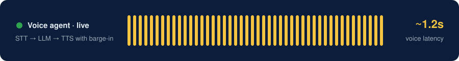

  

  

  
  
  

  
  
  
  

  

## About

AI Engineer with **5 years** of software engineering experience, including **3 years** building production LLM and real-time voice AI systems. I lead engineering on **IntellyMind** at Intellylabs, a suite of autonomous voice agents for recruiting, sales and customer support. I also solo-built **AgentLink**, an AI recruiter that is live in production.

  

---

## Flagship project: AgentLink

> **An AI recruiter that calls you.** Enter your phone number at **[agentlink.pro/demo](https://www.agentlink.pro/demo)** and it screens you by phone within ~30 seconds.

  

- **End-to-end AI recruiter:** it parses a JD into a scoring rubric, ranks every applicant, phone-screens the shortlist with a Retell voice agent, scores the transcript, and books qualified candidates onto Google Calendar with Meet links.
- **Custom persisted workflow engine** (replacing LangGraph for reliability) with Postgres-backed runs, step retries and a crash-recovery sweep. Calls honor callback requests ("call me Sunday 5 PM"), resume dropped calls mid-screen, and cap retries.
- **Production hardening:** LLM cost guardrails (per-campaign budgets, prompt caching, model fallback), integrity-risk scoring, and pgvector for semantic talent rediscovery.

  
  
  
  
  
  
  

---

## Experience

<b>Multilingual Inbound Voice AI Agent</b> (Intellylabs): 9 languages · 18,000 calls/month · ~INR 11.85 per call

 

- Plivo streams bidirectional WSS audio into a **Pipecat** pipeline with VAD, turn detection and barge-in cancellation.
- **Language routing** auto-detects the caller's language on the first response and locks it. Sarvam covers 7 Indian languages and Azure Speech covers Filipino and Arabic.
- **Grounded reasoning:** Gemini 2.5 Flash tool calling with Pydantic validation, backed by read-only Postgres queries checked with SQLGlot.
- **Observability:** Langfuse tracing, LLM-as-judge scoring on a 5% call sample, and CloudWatch alerts, running on ECS Fargate.

<b>Autonomous Voice Hiring Agent</b> (Intellylabs): built from scratch, no voice framework · ~1.2s latency

 

- WebSocket audio streaming with STT → LLM → TTS orchestration and interruption handling in FastAPI.
- Latency budget: self-hosted FasterWhisper (300ms) + LLM (600ms) + TTS (300ms), with Silero VAD barge-in.
- A RAG pipeline (ChromaDB + BGE-Reranker) generates role-specific questions. It scored a **95% pass rate** on an LLM-as-judge eval over 500 JD/question pairs.

<b>Sales & Lead Qualification Agent</b> (Intellylabs): BANT scoring · hybrid model routing

 

- An outbound agent with Apollo.io enrichment and BANT lead scoring over call transcripts.
- Hybrid routing sends intent to local Ollama and reasoning to GPT-4o, which cut inference cost.

| When | Role | Highlights |
|---|---|---|
| **Mar 2025 – now** | AI Engineer & Product Developer, **Intellylabs** (Remote) | Lead engineer on IntellyMind voice agents |
| **Oct 2021 – Feb 2025** | Software Engineer, **Credex Technology** (Noida) | LLM MVPs with the OpenAI API (2023); mobile apps in Kotlin, Swift and Flutter; **−30%** dashboard load time; **−40%** deploy time |
| **2018 – 2022** | B.Tech, Computer Science, **GLA University** | |

---

## Tech stack

| Area | Tools |
|---|---|
| **LLM & agents** |       |
| **RAG & eval** |      |
| **Voice AI** |        |
| **Backend** |        |
| **Cloud & DevOps** | -232F3E?style=flat-square&logo=amazonwebservices&logoColor=white)    |
| **Frontend & mobile** |      |

---

## GitHub activity

  
  

  

  <picture>
    <source media="(prefers-color-scheme: dark)" srcset="https://raw.githubusercontent.com/abhinag007/abhinag007/output/github-snake-dark.svg" />
    
  </picture>

---

  <b>Hiring for AI agents, voice AI or LLM infrastructure?</b> 
  <a href="https://www.agentlink.pro/demo">Try AgentLink</a> · <a href="https://linkedin.com/in/abhijeet-nag">Connect on LinkedIn</a> · <a href="mailto:abhijeetnag0@gmail.com">Email me</a>

  

